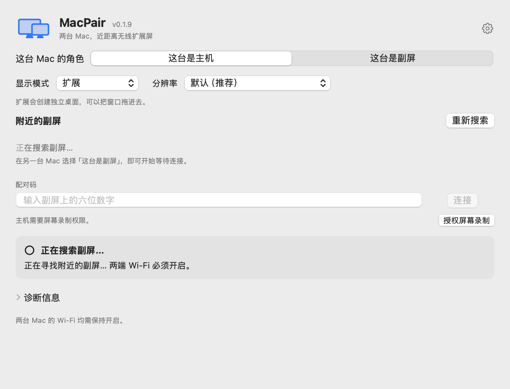

<p align="center"></p>

# MacPair

**两台 Mac，更多空间。**

[下载 v0.1.9](https://github.com/catstats/MacPair/releases/tag/v0.1.9) · [中文官网](https://macpair-display.resourcefulflint.chatgpt.site/zh/) · [English](README.md)

**v0.1.9** · 默认英文；右上角齿轮 → Settings → Language 可切换「简体中文」。[English guide](README.md) · [中文测试指南](TESTING.zh-CN.md)

原生 macOS 无线副屏 App。支持 Mirror（镜像主屏幕）和 Extend（扩展独立桌面）。两台 Mac 不必连接同一个 Wi-Fi；请让它们靠近，并保持 Wi-Fi 开关开启。

**2026-11-16 用户实测反馈：虚拟屏和不同 Wi-Fi 下的双 Mac 副屏通过；用户所述“没有 Wi-Fi”的情况未通过。** 尚未明确该情况是关闭了 Wi-Fi 开关，还是开着无线但未连接任何网络，因此独立无接入点模式暂不记为通过。详见 [测试记录](TESTING.zh-CN.md)。



*由真实 App 构建渲染的界面示例，并非双 Mac 实时投屏录像。*

## 打开 MacPair

双击项目根目录的「Start MacPair.command」即可启动。iCloud 项目的运行 App 与编译缓存保存在本机 ~/Library/Caches/MacPair/<项目编号>，启动器会自动定位；构建命令也会显示完整 App 路径。普通本地目录仍默认使用 build/MacPair.app。

把 `build/MacPair-0.1.9.zip` 复制到另一台 Mac，解压后打开其中的 MacPair.app。包内附完整源码。另一台 Mac 不需要安装 Xcode。

要求：两端 macOS 13 或以上，支持 Apple 点对点 Wi-Fi 的无线硬件。提供 arm64 和 x86_64 通用构建；开发环境是 Apple Silicon；用户验收设备的处理器与系统版本尚未单独记录。

App 使用本地临时签名，没有 Apple 公证。如果系统拦截自己构建的 App，可到「系统设置 → 隐私与安全性」按系统提示允许打开。无需关闭 SIP 或全局 Gatekeeper。

## 自动发现与连接卡片

MacPair 会记住上次的主机／副屏角色。打开主机 App 自动搜索；打开副屏 App 自动等待。首次选择「这台是副屏」也会直接开始等待，无需再点搜索或等待按钮。两端仍需运行 MacPair，并保持 Wi-Fi 开启。

发现具备直连接口和设备身份的可用副屏后，会出现自己的原生连接卡片。选择镜像或扩展，点「连接」即可继续现有流程：首次仍需六位数字，已配对的 Mac 免输码。仅发现设备不会自动认证或开始屏幕传输。

弹出卡片不激活 App、不抢输入焦点；设备离开时关闭卡片。点击关闭后，当前搜索不再反复弹出，重新搜索或重开 App 可恢复提示。「设置 → 自动寻找副屏」可关闭自动搜索。手动停止副屏等待后，不会马上自动重启等待。

这是根据设备可发现状态触发，不是实际距离测量；没有加入 BLE，也没有安装开机启动或常驻系统服务。主机尚未获得屏幕录制权限时，点击连接会回到主窗口，按原有提示授权。不会自动恢复已断开的屏幕会话。

## 首次六位数字，以后免输码

**建议两台 Mac 都使用 0.1.9。** 协议 v3、角色记忆及 0.1.6–0.1.8 已保存的配对保持兼容；连接旧版时回退到原来的 30 fps 路径。

- 新设备首次输入随机的**六位数字**，保留开头的 0；粘贴时允许空格或短横线。配对码**五分钟有效，成功认证后即失效**。
- 两端确认保存成功后，App 将**高强度设备凭据保存在本机 macOS 登录钥匙串**，不保存六位数字码，也不会通过 iCloud 同步凭据。
- 以后打开 App，让副屏保持等待，主机选中这台 Mac 后直接连接即可；**无需再次输入配对码**。重开 App、交换主副屏角色后也能使用已保存的配对。这仍需主动点击连接，不会自动恢复睡眠后中断的会话。
- 短码过期后，已配对的 Mac 仍能连接；添加新 Mac 时再点「换一个码」。
- 两端都可在断开时通过「设置 → 已配对的 Mac → 忘记」撤销信任。任一端忘记后，需要重新配对；另一端可能也需要先忘记旧记录。设备名称相同不会自动获得信任。
- 累计五次失败会暂停等待三十秒，之后需用户重新点击等待；重新开始等待不能绕过尚未结束的暂停。
- 如果钥匙串访问失败，本次仍可加密连接，但界面会说明没有记住设备；另一端未确认保存时，会清理此次未完成的保存记录。

短码使用现成的 **BoringSSL SPAKE2 密码认证密钥交换**，不会直接哈希成 TLS 密钥。相互验证后，使用独立的双向 AES-256-GCM 密钥与严格序号保护数据；免码连接也会用强设备凭据重新协商会话密钥。配对实现尚未经过独立安全审计。

## 选择镜像或扩展

建议两台 Mac 都使用 **0.1.9**。主机在连接前选择模式：

- **Mirror（镜像）**：显示主机现有主屏幕，保留屏幕比例缩放，不创建虚拟显示器；点击 **Connect（连接）**。
- **Extend（扩展）**：按副屏尺寸及 1×/2× 缩放创建独立桌面，可以把窗口拖过去；点击 **Connect（连接）**。

切换模式时先断开，再选择另一模式并重新连接。副屏自动接收对应模式。镜像使用公开的屏幕捕获接口；非公开虚拟屏接口只用于扩展模式。

## 扩展屏分辨率

**建议两台 Mac 都使用 0.1.9**，新版尺寸协商使用协议 v3。在主机连接前选择「显示分辨率」：

| 选项 | 桌面空间 | 副屏文字大小 |
| --- | --- | --- |
| Larger Text（更大文字） | 默认逻辑尺寸的约 80% | 更大 |
| Default（默认，推荐） | 匹配副屏实际全屏区域及 macOS 缩放 | 匹配系统设置 |
| More Space（更多空间） | 默认逻辑尺寸的约 125% | 更小 |

Retina 副屏使用 2× HiDPI。例如 1280 × 832 逻辑点的全屏区域会对应 2560 × 1664 传输像素。刘海屏会在全屏完成后测量实际画面区域，避免直接使用整块屏幕尺寸而拉伸。1× 下的奇数尺寸会就近取偶数以适配 H.264；画面始终保持比例。

接收画面角落显示桌面逻辑点数、1×/2× 缩放、实际 H.264 像素和帧率。两端「复制诊断信息」还会包含副屏全屏区域、捕获及编码尺寸。更改分辨率档位、接收屏幕或 macOS 显示缩放后，请断开重连。退出全屏后仍保持协商的分辨率，画面缩放适应窗口。

当前传输限制为单边最大 5120 像素、总计约 1600 万像素，实际编码能力因机型而异。分辨率被拒绝时可改选「更大文字」。不会静默回退到旧版固定的 1280 × 800。

## 第一次连接

1. 两台 Mac 放在附近，**Wi-Fi 开关保持开启**。
2. 副屏选择「这台是副屏」，会自动等待连接；如果之前手动停止了，点「作为副屏等待连接」。
3. 如提示「本地网络」或入站连接，请允许。
4. 主机会自动搜索并弹出连接卡片，也可手动搜索并选中标有「可以连接」的 Mac。
5. 首次在卡片或主界面的「配对码」输入框填写副屏的六位数字；已配对的 Mac 无需输码。
6. 选择镜像或扩展，然后点击 **Connect（连接）**。主机需要屏幕录制权限；按提示授权后退出并重新打开同一个 App。
7. 副屏会自动全屏。按 **Esc** 或双击可以退出全屏；使用主机的键盘和触控板操作。

窗口约 720 × 550，日常操作无需滚动。语言及已配对的 Mac 位于齿轮「设置」中。「诊断信息 → 测试直连」仅检查加密连接，不录制或传输屏幕，也不需要屏幕录制权限；测试后先断开，再点「连接」传输画面。

断开时状态显示「已断开」，以前的 RTT 和帧数显示为「上次连接」，不会与实时 FPS 混在一起。RTT 是网络心跳往返时间，不能代表完整屏幕链路延迟。

扩展模式中，把窗口拖出主机桌面右边缘即可在副屏显示；「调整显示器排列」可更改相对位置。停止会话会停止捕获并移除虚拟屏，其窗口会移回现有屏幕。副屏可继续等待下次连接。

## 0.1.9：改善拖动和滚动的跟手性

实际链路是 ScreenCaptureKit → VideoToolbox H.264 → 加密 TCP/AWDL → AVSampleBufferDisplayLayer。系统显示层负责解码及呈现，目前没有自写 Metal 渲染器或 HEVC 编码。

- 捕获改用 NV12/420v 和 Rec.709 色彩矩阵，保留协商的像素尺寸及 Retina 缩放，不自动降低分辨率。
- 请求硬件低延迟编码；不可用时回退到普通实时编码。诊断包含实际编码器 ID 和硬件属性查询结果。本机 RTVC 编码服务不支持该属性查询，记录为「未上报」，不将其误记为软件编码。
- 两端新版可重叠编码和发送，整条链路最多两帧在途，另保留一个可替换的最新原始画面。只替换尚未编码的原始帧，不丢弃已经编码、可能被后续帧引用的 H.264 帧。
- 接收端把帧提交给系统显示层后才返回加密确认，显示层暂未准备好时应用背压，避免 TCP 或界面队列堆积旧画面。确认并不等于屏幕已实际呈现。
- 样本构建移到独立队列；界面统计每秒更新，不再每帧刷新 SwiftUI。

「诊断信息」增加捕获／编码／发送／确认速率、编码平均及 p95、原始帧等待、本机发送，以及副屏队列／样本构建／显示提交等待。「捕获回调 → 副屏提交 → 确认」包含返回链路，不能当作单向网络或完整显示延迟。FPS 是视频更新／提交数，不是屏幕刷新率；静止桌面可以产生很少的新帧。

实机比较时，两端都用 0.1.9，保持相同分辨率档位，连续拖动窗口或滚动 10–15 秒。若仍有延迟，请在两端分别复制诊断，查看哪一段速率下降、p95 升高。生成画面基准和回环检查不能代替双机无线实测。

## 如何确认没有用到路由器

主机只允许连接 Bonjour 发现结果中的 `awdl*` 接口，并把 `NWParameters.requiredInterface` 设为这个接口。**没有 AWDL 接口时，连接按钮不能使用；不会自动回退到校园网或热点。**

验收时让两台 Mac 都断开路由器/手机热点的网络连接，但 **不要关闭 Wi-Fi 无线开关**，并拔掉以太网/Thunderbolt 网线。随后重新搜索，先做直连测试，再传输屏幕。这比在共同 Wi-Fi 下观察“能连上”更有说服力。

诊断栏的“网络路径”显示 Network.framework 报告的接口名；代码中的接口限定与断开公共网络的测试一起确认这条路径。需要现场测量实际时延、距离和吞吐，不预先承诺某个延迟数值。

## 首版范围

- 镜像主屏幕：按原比例缩放到 1280 × 800 内，兼容竖屏与超宽屏。
- 真正的扩展桌面；根据副屏的逻辑尺寸、实际全屏区域和 1×/2× Retina 缩放协商分辨率，两端新版时目标上限 60 fps，连接旧版时保持 30 fps。
- Bonjour 自动发现 + Apple 点对点 Wi-Fi（AWDL）。
- 首次通过六位数字码配对，SPAKE2 认证后使用 AES-256-GCM 加密；已配对设备的强凭据保存在本机钥匙串中。
- ScreenCaptureKit 捕获扩展虚拟屏或现有镜像主屏幕，VideoToolbox H.264 编码；码率按像素数量设为 8–45 Mbps，并非网络拥塞自适应。
- AVSampleBufferDisplayLayer 解码显示，接收端支持窗口/全屏。
- 心跳、往返时间、会话超时、断开清理、复制诊断信息。
- **用主机的键盘、鼠标/触控板操作。** 首版不转发副屏键鼠、不传声音、不做网络拥塞自适应、多副屏或自动重连。

fps 统计的是实际发送/接收的新帧数；静止画面时 ScreenCaptureKit 可能不产生新帧，显示 0 fps 不代表断线。往返时间是网络心跳 RTT，**不是**“鼠标到画面”的端到端延迟。

## 构建与测试

使用系统框架及随源码附带的 Swift Crypto/BoringSSL C 实现，不在线下载 Swift 包，不需要付费开发者账号。编译机需要包含 Swift 6 的 Xcode 和 macOS SDK；加密库静态编入 App，另一台 Mac 不需要额外安装依赖。

```bash
./scripts/build.sh            # arm64 + x86_64 通用 App
./scripts/build.sh --native   # 仅当前架构，开发时更快
./scripts/test.sh             # 实际安全配对、协议及视频编解码测试
./scripts/test.sh --pairing   # 免码重连、忘记设备、限次及钥匙串持久化检查
./scripts/test.sh --display   # 创建/移除真实 1×/2× 虚拟屏，短暂全屏测量尺寸
./scripts/package.sh          # App + 说明 + 完整源码的 zip
```

测试不会自动授予系统权限，不会为了测试去录制已有桌面。不要在授予屏幕录制权限后反复重签同一测试会话中的 App；先完成构建，再授权并重启。Bundle ID 保持为 `local.macpair.prototype`。

## 架构与限制

```text
主机 Mac                               副屏 Mac
CGVirtualDisplay → 独立桌面
  ↓
ScreenCaptureKit → H.264 编码
  ↓
SPAKE2 → AES-GCM / TCP ─── AWDL 点对点 Wi-Fi ───→ 解码与全屏显示
  ↑                                     ↓
  └────────────── 心跳 / RTT ────────────┘
```

**CGVirtualDisplay 是 macOS 非公开接口。** 不需要安装驱动，但系统升级可能使它失效；这里不是承诺可以上架 App Store 或保证所有 Mac 兼容。接口异常由 Objective-C 桥接层处理，失败会报告给用户。MacPair 不依赖 OpenDisplay 的完整应用、自动更新器或云端服务。

无线发现受机型、系统权限、无线开关、无线环境及 AWDL 支持影响。首版保留严格接口选择，宁可报告无法发现，也不把局域网连接冒充成无需路由器的成功。

## 排障

| 现象 | 处理 |
| --- | --- |
| 找不到副屏 | 确认副屏已开始等待；两端 Wi-Fi 开启；允许本地网络；主机重新搜索 |
| 只显示“尚未发现点对点接口” | 保持 Wi-Fi 开启，靠近两台机器，确认权限后重试；此时不会回退到局域网 |
| 配对失败/超时 | 输入当前副屏显示的完整配对码；停止再重新等待会改变配对码 |
| 测试直连成功，扩展失败 | 检查主机屏幕录制权限；授权后退出并重开同一个 App；查看诊断错误 |
| 画面黑但帧数增加 | 在主机把一个普通窗口拖到扩展桌面；受保护内容可能不被捕获 |
| 窗口拖不进去 | 点“调整显示器排列”，查看 MacPair 所在方向 |
| 钥匙串反复询问 | 对 MacPair 的已保存配对条目选择“始终允许”，可保留访问授权；当前 App 在同次使用中可能多次读取凭证，这是已知待优化项。 |
| 睡眠后断开 | 本版检测超时并清理；唤醒后手动重新连接 |
| 需要报告问题 | 两端点击“复制诊断信息”，保留系统版本、接口、错误、帧数；不包含配对码 |

## 后续修改和提交

在本项目中修改源码，按前面的命令构建和检查。AirDrop 安装包与界面预览放在 build/，已被 Git 忽略。iCloud 项目的运行 App 和编译缓存保存在本机缓存目录，避免云同步附加的 Finder 元数据影响签名；各脚本统一使用 scripts/project-paths.sh 定位。

```bash
git status
./scripts/build.sh --native
./scripts/test.sh
git diff
git add -A
git commit -m "Describe the change"
```

## 品牌素材

两个原始 Logo 保存在 Resources/Branding/。MacPair_Icon.png 用作软件图标，构建时自动生成 macOS 所需的 .icns 文件。

## 参考与许可

- [Apple：选择网络 API（点对点 Wi-Fi）](https://developer.apple.com/documentation/technotes/tn3151-choosing-the-right-networking-api)
- [Apple：includePeerToPeer](https://developer.apple.com/documentation/network/nwparameters/includepeertopeer)
- [Apple：ScreenCaptureKit 示例](https://developer.apple.com/documentation/screencapturekit/capturing-screen-content-in-macos)
- [OpenDisplay](https://github.com/peetzweg/opendisplay)：虚拟屏接口定义的来源，GPL-3.0。
- [OpenAirDisplay](https://github.com/nmt3325/openairdisplay)：相关的 AWDL 方向工作；MacPair 未克隆或依赖该分支。

本项目采用 GPL-3.0-only，完整条款见 LICENSE，第三方来源见 THIRD_PARTY_NOTICES.md。
